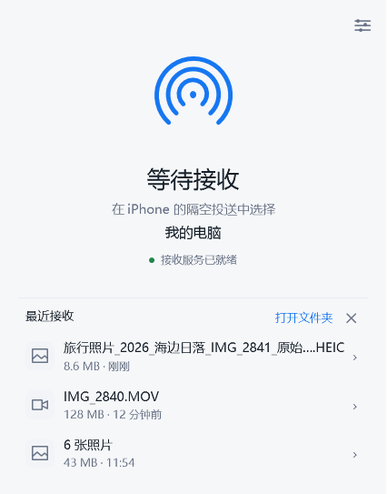

# DropLink

在 iPhone 的「隔空投送」里选中电脑，把照片、视频和文件直接发到 Windows。手机无需安装应用，电脑可以留在后台接收。

**[下载 Windows x64 升级包](https://github.com/soberbw-hash/DropLink/releases/latest)** · [支持的网卡](docs/HARDWARE_COMPATIBILITY.md) · [恢复驱动](docs/DRIVER_RECOVERY.md)

升级包适用于已有 `DropLink.exe` 和 `runtime` 文件夹的便携版。首次安装所需的完整无线运行包暂未公开提供。[分发说明](docs/LICENSES.md)

## 使用

1. 双击 **DropLink.exe**。首次使用按向导配置专用 USB 网卡，已验证型号为 **RTL8811CU（0BDA:C811）**。这张卡用于接收，电脑可通过其他网卡或有线上网。
2. 界面显示「等待接收」后，在 iPhone 上点 **分享 → 隔空投送 → 电脑名称**。
3. 点 **打开文件夹** 查看收件。关闭窗口时选 **留在后台**，下次可直接投送。

默认逐次确认。在自己的电脑上，可以在设置里开启 **自动接收** 和 **登录后在后台启动**。



## 升级

从托盘退出 DropLink，将升级 ZIP 中的内容解压到原 `DropLink.exe` 所在目录，允许替换同名文件，再用原快捷方式启动。原设置、接收记录和文件会保留。

## 开发

Windows 界面使用 C# 和 WPF，接收引擎使用 Python。开发环境需要 .NET 10 SDK 和 Python 3.12。

```powershell
dotnet build src/DropLink/DropLink.csproj -c Release
python -m unittest discover -s tests
dotnet run --project tests/EngineClientChecks
```

[构建与打包](tools/portable/README.md) · [第三方许可](docs/LICENSES.md)
